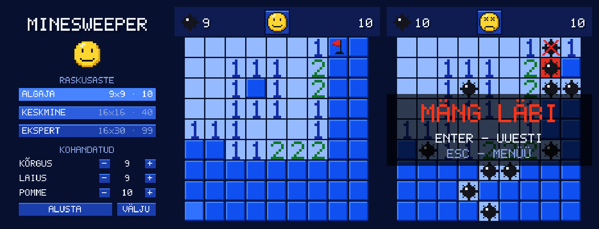

# Minesweeper

A clone of the classic *Minesweeper* in C++17 with [SFML 3](https://www.sfml-dev.org). It started as
a group project and now has a pixel-art interface with a start menu, difficulty levels and custom
boards.



## Features

- **Start menu** with the classic difficulty levels (beginner 9×9 · 10 mines, intermediate
  16×16 · 40, expert 16×30 · 99) or a custom height, width and mine count
- **Safe first move**: the first opened cell is never a mine, and when there is room its
  neighbours are free too, so the first click opens an area
- **Flood fill**: opening an empty cell opens the whole empty area and the numbers around it
- **Chording**: clicking an opened number opens its neighbours once enough flags are placed
- **Status bar** with the mines left to flag, a face that doubles as the new-game button, and a timer
- **End of game**: a wave spreads across the board (red on a loss, white on a win); after a loss the
  mines are shown, the one that went off in red, and wrong flags are crossed out
- **Sharp pixel art at any size**: everything (font, flag, mine, face) is drawn in code and scaled
  by a whole number to fit the screen
- The in-game text is in Estonian

## Controls

| Input | In the game | In the menu |
|---|---|---|
| Left click | open a cell; on a number: open its neighbours | press a button |
| Right click | place or remove a flag | |
| Middle click | open the neighbours of a number | |
| Click the face | new game | |
| Enter / F2 | new game with the same settings | start (Enter) |
| Esc | back to the menu | quit |
| 1, 2, 3 | | choose beginner, intermediate or expert |

You win by opening every cell without a mine; flags are optional.

## Quick start

Install a C++17 compiler and SFML 3 (see [docs/building.md](docs/building.md) for Windows, Linux
and macOS), then:

```shell
make            # Windows PowerShell/cmd: mingw32-make
./bin/rungame   # Windows: .\bin\rungame.exe
```

or with CMake:

```shell
cmake -S . -B build -G Ninja -DCMAKE_BUILD_TYPE=Release
cmake --build build
./build/bin/rungame
```

Run the tests with `make test` or `ctest --test-dir build`.

## Documentation

- [docs/building.md](docs/building.md): installing the tools, every Makefile and CMake command,
  CLion setup, code formatting and troubleshooting
- [archive/classic](archive/classic): the first version of the game (terminal or a simple window
  with image files)

## Project structure

```text
.
├── inc/                     headers
│   ├── minesweeper.hpp      game logic (does not depend on SFML)
│   └── gui/                 interface headers
├── src/                     sources
│   ├── main.cpp             starts the graphical application
│   ├── minesweeper.cpp      game logic
│   └── gui/
│       ├── app.cpp          window and switching between menu and game
│       ├── menu_screen.cpp  start menu (difficulty, custom board)
│       ├── game_screen.cpp  board, status bar, end-of-game wave and banner
│       ├── pixel_font.cpp   5x7 pixel font (with Õ Ä Ö Ü)
│       ├── icons.cpp        flag, mine and face pixel art
│       └── canvas.cpp, screen.cpp (+ theme.hpp)  drawing, buttons, colours
├── tests/
│   └── minesweeper_test.cpp game logic tests (no window needed)
├── archive/classic/         the first version of the game
├── docs/                    build guide and screenshot
├── .github/workflows/       CI: builds and tests on Linux, Windows (MSYS2) and macOS
├── .clang-format            code style
├── CMakeLists.txt           CMake build (game, classic version, tests)
└── Makefile                 make build (game and tests into obj/, lib/, bin/)
```

The game logic in `minesweeper.hpp` has no SFML dependency, so it is tested on its own; both the
new interface and the classic version draw the board through `Minesweeper::cell()`.

## Credits

- Originally a group project; the original repository is
  [MartinMaenniste/cppRyhmatoo](https://github.com/MartinMaenniste/cppRyhmatoo).
- The visual style (blue pixel grid, reacting face, end-of-game wave) is inspired by
  [Kofybrek/Minesweeper](https://github.com/Kofybrek/Minesweeper). No code or images were copied:
  the code and pixel art in this project are its own.
